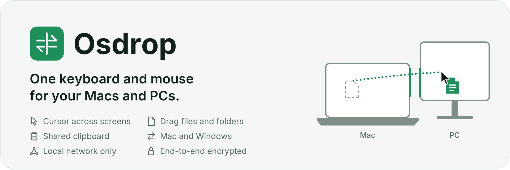
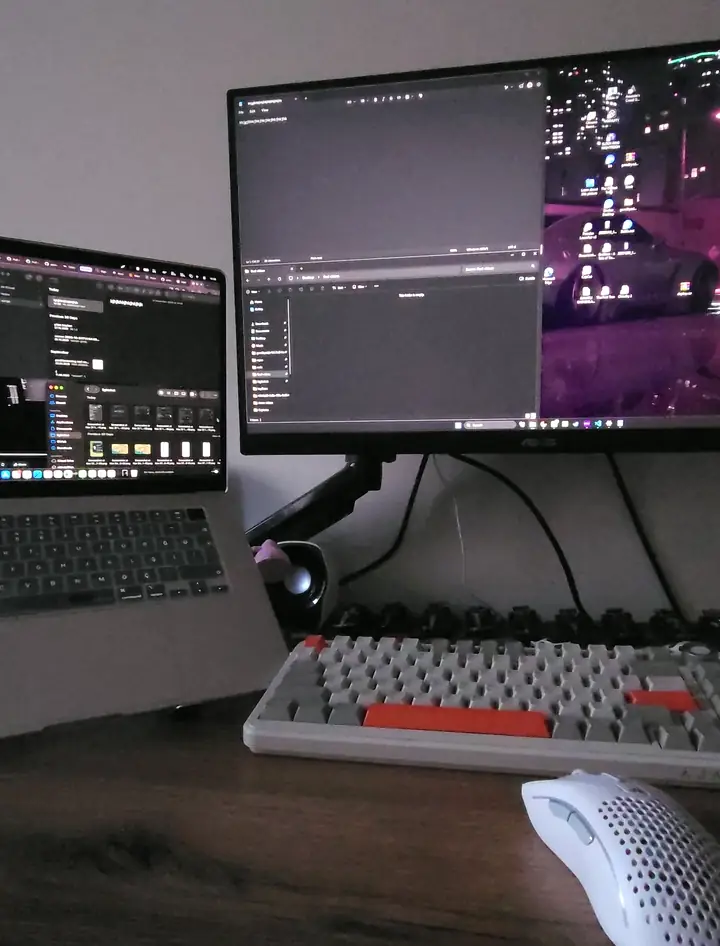
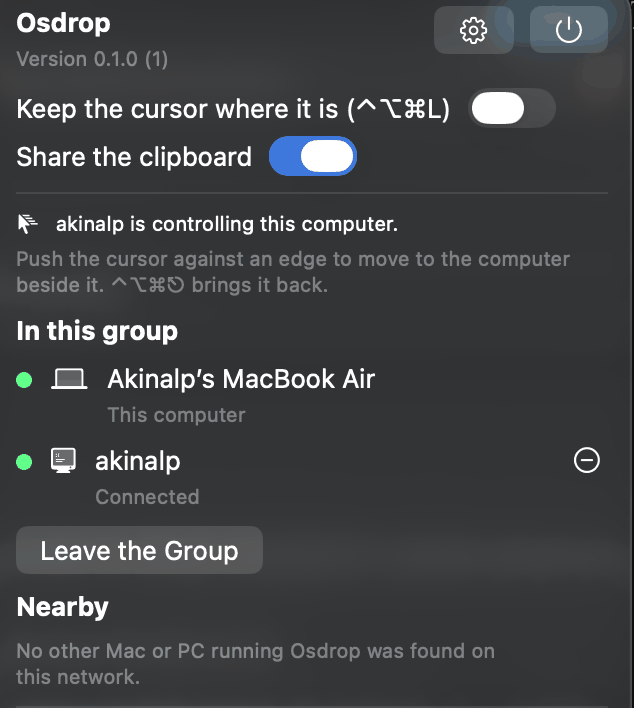
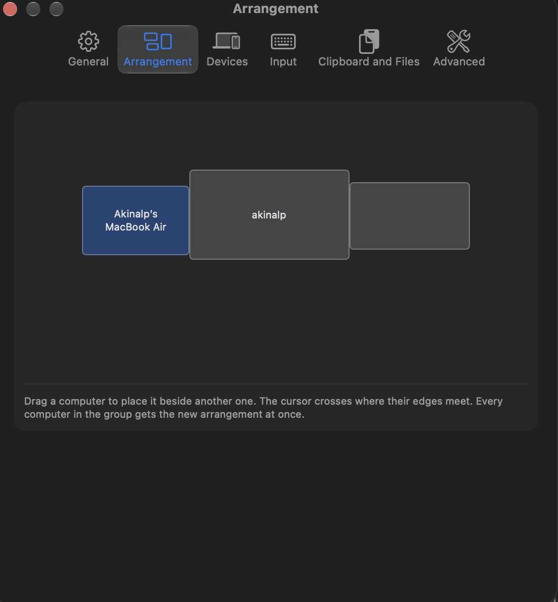
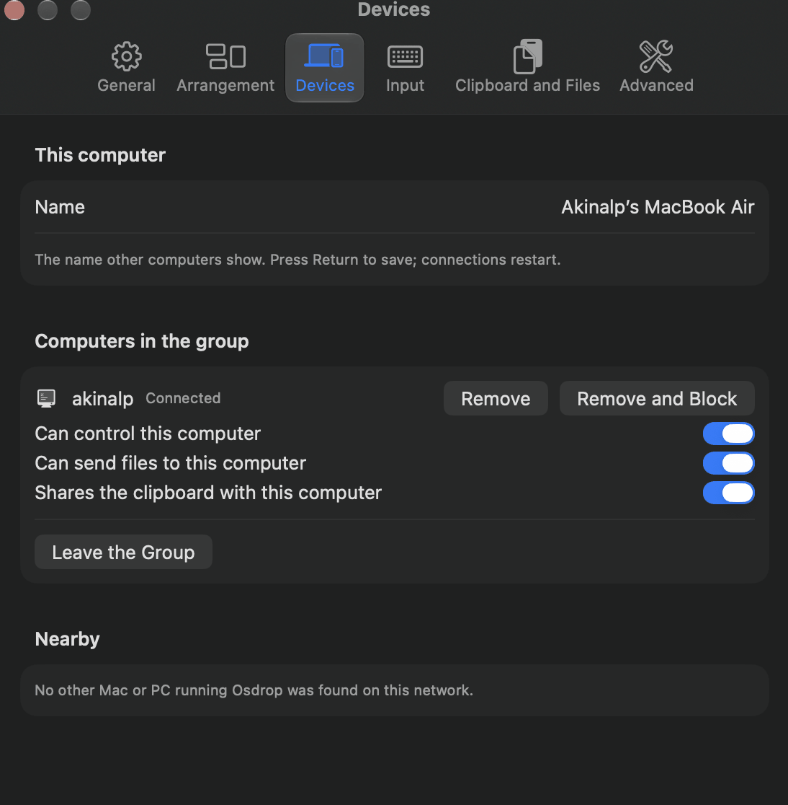
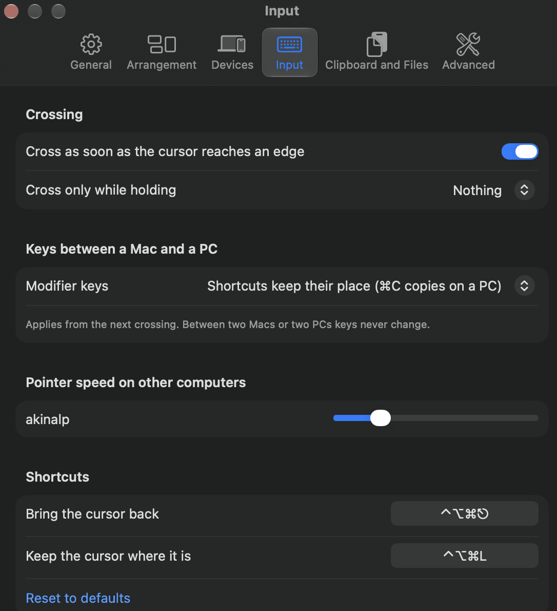
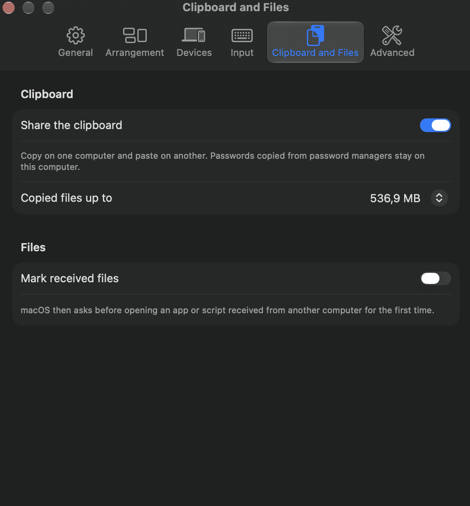

<a href="README.tr.md">Türkçe</a>

  <picture>
    <source media="(prefers-color-scheme: dark)" srcset="docs/media/banner-dark.png">
    
  </picture>

  &nbsp;&nbsp;
  

  
  
  
  

  
   Files dragged from a MacBook across the edge, straight into a folder on the PC.

## Features

- **One keyboard and mouse.** Push the cursor through a screen edge and it carries on on the computer
  beside it, with the keyboard. Each computer keeps its own monitors and desktop.
- **Drag files across.** Drag files and folders over the edge and drop them where you want them, in
  Finder, Explorer, a mail or a browser upload field. Photos and Mail attachments work too.
- **Shared clipboard.** Copy text, images or files on one computer and paste them on another.
- **Every direction.** Mac ⇄ Windows, Mac ⇄ Mac and Windows ⇄ Windows, up to eight computers in one
  arrangement.
- **Shortcuts keep their place.** ⌘C on a Mac is Ctrl+C on a PC, and the other way round.
- **Local and private.** No cloud, no account. Computers pair once with a 6-digit code, every
  connection is end-to-end encrypted, and each computer decides what the others may do.

## How Osdrop compares

✅ yes · 🟡 partly or with extra setup · ❌ no

| | **Osdrop** | Universal Control | Mouse Without Borders | Deskflow | Synergy |
|---|:---:|:---:|:---:|:---:|:---:|
| Price | **Free, open source** | Free, built into macOS | Free (PowerToys) | Free, open source | Paid, from $49 |
| Mac and Windows together | ✅ | ❌ Apple only | ❌ Windows only | ✅ | ✅ |
| Drag files across the edge, dropped where you release | ✅ files and folders | ✅ | 🟡 one file, up to 100 MB | ❌ | ❌ |
| Shared clipboard with files | ✅ | ✅ | 🟡 one file, up to 100 MB | ❌ text and images | ❌ text and images |
| Pairing and encryption | ✅ 6-digit code, end-to-end | 🟡 same Apple Account | 🟡 a shared security key | 🟡 TLS | 🟡 TLS in Plus and Max |
| No account, no cloud | ✅ | ❌ Apple Account | ✅ | ✅ | 🟡 licence activated online |
| Linux | ❌ | ❌ | ❌ | ✅ | ✅ |

Osdrop is made for people who sit in front of a Mac and a Windows PC every day and want them to
feel like one computer, for free. Another tool fits better if you need Linux (Deskflow, Input Leap,
Synergy) or an iPad (Universal Control).

Compared in November 2026 from each product's own pages:
[Universal Control](https://support.apple.com/en-us/102459),
[Universal Clipboard](https://support.apple.com/102430),
[Mouse Without Borders](https://learn.microsoft.com/en-us/windows/powertoys/mouse-without-borders),
[Deskflow](https://github.com/deskflow/deskflow) and its
[protocol notes](https://deskflow.github.io/deskflow/group__protocol__files.html),
[Synergy features](https://symless.com/synergy/features) and [pricing](https://symless.com/pricing).
Features and prices change; corrections are welcome.

## How it works

1. **Install** Osdrop on each computer.
2. On one of them, choose **Pair** next to the other computer and confirm the same 6-digit code on
   both screens.
3. In **Settings › Arrangement**, place the computers where they stand on your desk.
4. Push the cursor through the edge.

Paired computers form a group and keep encrypted connections to each other. When the cursor crosses
an edge, the computer you are using stops moving its own cursor and sends your input to the
neighbour, which applies it as if its own mouse and keyboard were used. Dragged files are fetched
from the computer they came from while you drop them. One shared C++ core handles discovery,
pairing, encryption and the protocol for both apps; see [`docs/ARCHITECTURE.md`](docs/ARCHITECTURE.md).

 

## Screenshots

<table>
  <tr>
    <td></td>
    <td></td>
  </tr>
  <tr>
    <td align="center">Place the computers as they stand on your desk</td>
    <td align="center">Decide what each computer may do on this one</td>
  </tr>
  <tr>
    <td></td>
    <td></td>
  </tr>
  <tr>
    <td align="center">Crossing, keys between a Mac and a PC, pointer speed</td>
    <td align="center">Clipboard and files</td>
  </tr>
</table>

## Install

### macOS

1. Download [`Osdrop.dmg`](https://github.com/akinalpfdn/osdrop/releases/latest/download/Osdrop.dmg),
   open it and drag Osdrop to Applications.
2. Start Osdrop; it lives in the menu bar.
3. Allow **Accessibility** (to read and drive the keyboard and mouse) and **Local Network** (to find
   the other computers) when Osdrop asks.

### Windows

1. Download [`Osdrop-Setup.exe`](https://github.com/akinalpfdn/osdrop/releases/latest/download/Osdrop-Setup.exe)
   and run it.
2. The installer is not code-signed, so SmartScreen may say "Windows protected your PC": choose
   **More info › Run anyway**. Each release lists the installer's SHA-256.
3. The installer adds the app, the Osdrop Input service (which moves the cursor and types for the
   other computers) and a firewall rule. Osdrop lives in the notification area.

### Requirements

| | |
|---|---|
| **Mac** | macOS 14 Sonoma or later |
| **Windows** | Windows 10 22H2 or Windows 11, x64 |
| **Network** | All computers on the same local network, wired or Wi-Fi |

## Keyboard shortcuts

| Action | Mac | Windows |
|--------|-----|---------|
| Bring the cursor back to this computer | ⌃⌥⌘⎋ | Ctrl+Alt+Win+Esc |
| Keep the cursor on the computer it is on (press again to release) | ⌃⌥⌘L | Ctrl+Alt+Win+K |

Both can be changed in **Settings › Input**.

## FAQ

<b>Can I use my Mac's keyboard and mouse on my Windows PC?</b>

Yes. Pair the two, place them in Settings › Arrangement, and push the cursor toward the PC. It works
the other way round too: the PC's keyboard and mouse on the Mac.

<b>Can I drag a file from my Mac to my PC?</b>

Yes. Drag it across the edge with the cursor and drop it in any Explorer window or on the desktop.
Folders keep their whole tree. From the PC to the Mac works the same way.

<b>Does copy and paste work between a Mac and a PC?</b>

Yes: text, images and files. Passwords copied from password managers stay on the computer they were
copied on.

<b>Is it a Universal Control alternative for Windows?</b>

It does the same job between Macs and Windows PCs: one keyboard and mouse, files dragged across the
edge and a shared clipboard. It does not support iPads.

<b>Do I have to pick one computer as the server?</b>

No. There is no server or client: the computer whose keyboard and mouse you are using drives the
others, and any computer in the group can be that one.

<b>Is it based on Synergy or Deskflow?</b>

No. Osdrop has its own protocol and its own shared C++ core, and does not work with Synergy,
Deskflow, Barrier or Input Leap.

<b>Does it need the internet or an account?</b>

No. Everything stays on your local network, and there is no account or cloud service.

<b>The cursor stutters on my Mac over Wi-Fi. What can I do?</b>

Turn on **Settings › Advanced › Improve the connection over Wi-Fi**. It keeps AWDL, which AirDrop,
AirPlay and Sidecar use, off while Osdrop runs; see
[`docs/TROUBLESHOOTING.md`](docs/TROUBLESHOOTING.md#mac-the-cursor-stutters-over-wi-fi).

<b>Does it show the other computer's screen?</b>

No. Osdrop sends no picture of any screen; each computer keeps showing its own monitors. To use one
computer as an extra display of another, see [Osplay](https://github.com/akinalpfdn/osplay).

<b>Is it free?</b>

Yes. Osdrop is open source under the MIT license.

## More

- **Security:** computers pair once by confirming a 6-digit code on both screens; connections use
  the Noise protocol (X25519, ChaCha20-Poly1305, BLAKE2b), and each computer decides which others
  may control it, send it files and share its clipboard. See
  [`docs/SECURITY_MODEL.md`](docs/SECURITY_MODEL.md), and [`SECURITY.md`](SECURITY.md) to report a
  vulnerability.
- **Troubleshooting:** [`docs/TROUBLESHOOTING.md`](docs/TROUBLESHOOTING.md). Settings › Advanced ›
  Copy diagnostics makes a report for bug reports, with computer names hidden.
- **Building from source:** [`docs/BUILDING.md`](docs/BUILDING.md).
- **Contributing:** issues and pull requests are welcome; see [`CONTRIBUTING.md`](CONTRIBUTING.md) and
  the [Code of Conduct](CODE_OF_CONDUCT.md).

## License and credits

[MIT](LICENSE) © 2026 Akinalp Fidan. Osdrop builds on [Monocypher](https://monocypher.org),
[Asio](https://think-async.com/Asio/), [WPF-UI](https://github.com/lepoco/wpfui),
[H.NotifyIcon](https://github.com/HavenDV/H.NotifyIcon) and
[CommunityToolkit.Mvvm](https://github.com/CommunityToolkit/dotnet); full list in
[`docs/THIRD_PARTY.md`](docs/THIRD_PARTY.md).
