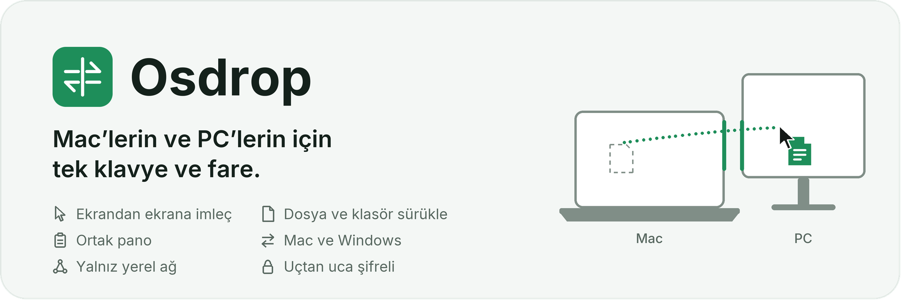
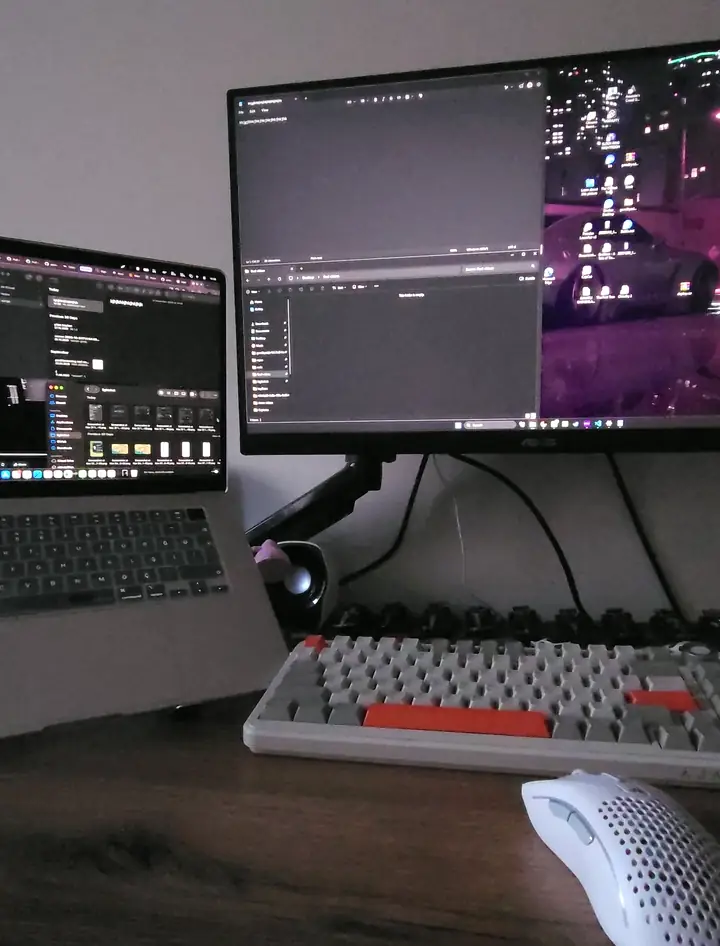
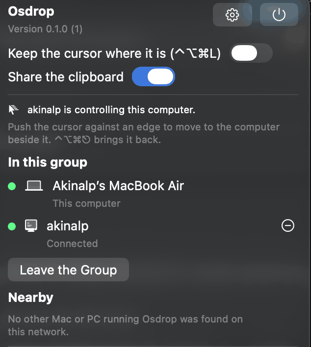
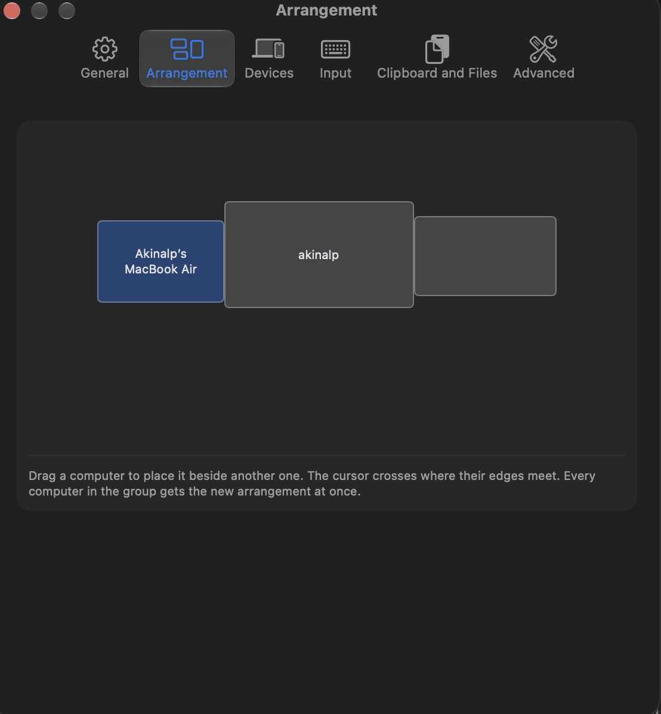
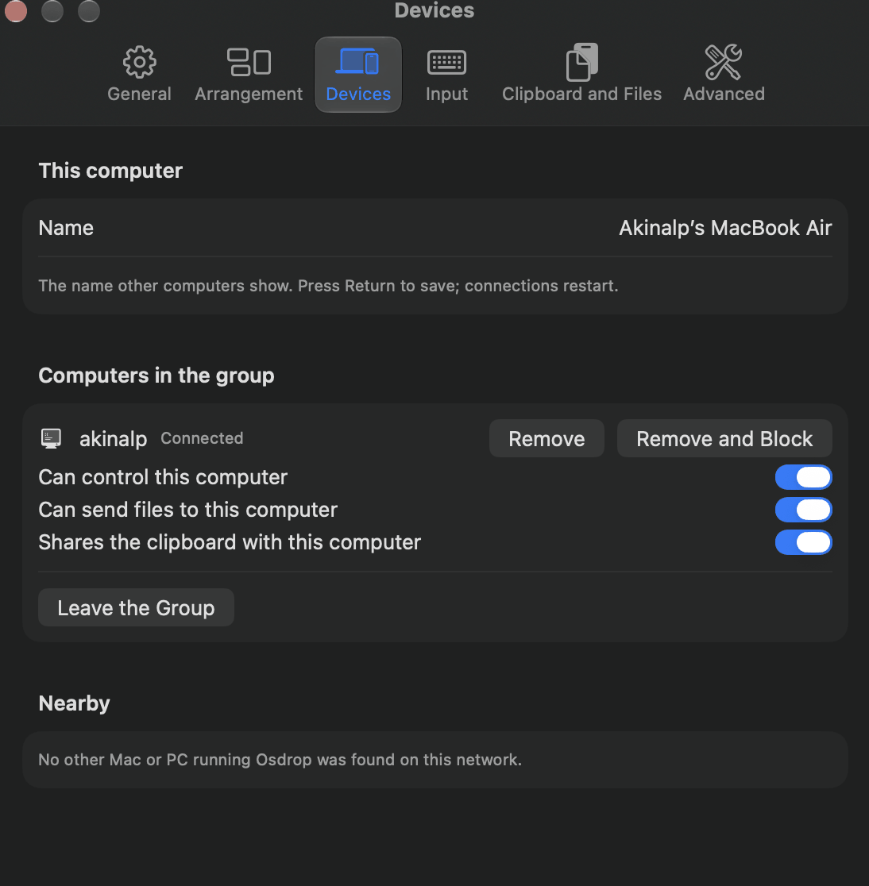
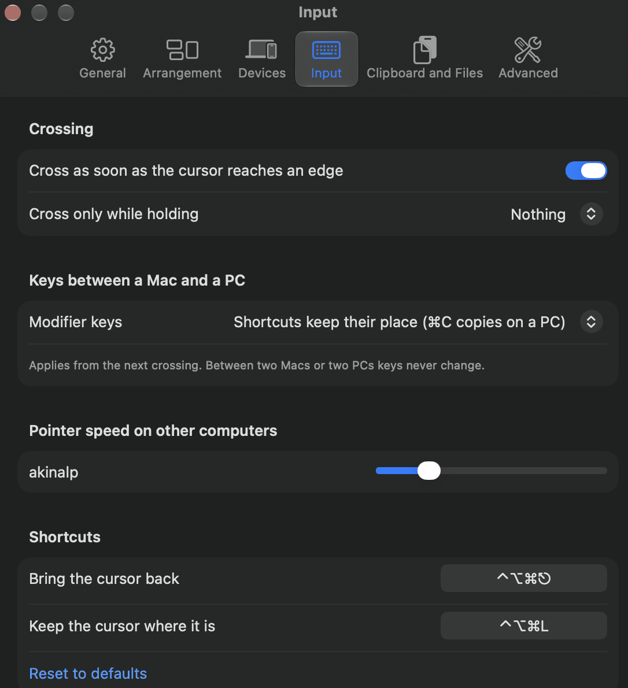
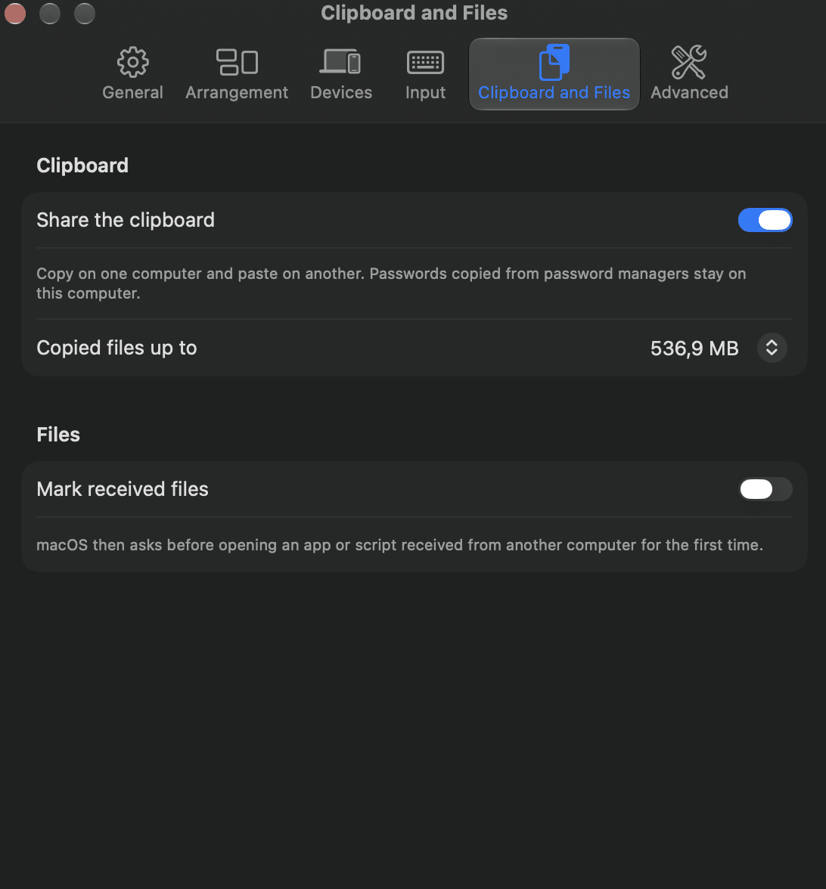

<a href="README.md">English</a>

  <picture>
    <source media="(prefers-color-scheme: dark)" srcset="docs/media/banner-dark.tr.png">
    
  </picture>

  &nbsp;&nbsp;
  

  
  
  
  

  
   MacBook'tan kenar üzerinden doğrudan PC'deki bir klasöre sürüklenen dosyalar.

## Özellikler

- **Tek klavye ve fare.** İmleci ekran kenarından geçirince yandaki bilgisayarda devam eder, klavye
  de onunla gider. Her bilgisayar kendi monitörlerini ve masaüstünü korur.
- **Dosyaları sürükleyerek geçir.** Dosya ve klasörleri kenardan sürükleyip istediğin yere bırak:
  Finder'a, Explorer'a, bir e-postaya ya da tarayıcının dosya yükleme alanına. Fotoğraflar ve Mail
  ekleri de çalışır.
- **Ortak pano.** Bir bilgisayarda metin, görüntü ya da dosya kopyala, başka birinde yapıştır.
- **Her yönde.** Mac ⇄ Windows, Mac ⇄ Mac ve Windows ⇄ Windows; tek düzende en çok sekiz bilgisayar.
- **Kısayollar yerinde kalır.** Mac'teki ⌘C, PC'de Ctrl+C olur; tersi de öyle.
- **Yerel ve gizli.** Bulut yok, hesap yok. Bilgisayarlar bir kez 6 haneli kodla eşleşir, her
  bağlantı uçtan uca şifrelidir ve her bilgisayar diğerlerinin ne yapabileceğine kendisi karar verir.

## Diğerleriyle karşılaştırma

✅ evet · 🟡 kısmen ya da ek kurulumla · ❌ hayır

| | **Osdrop** | Universal Control | Mouse Without Borders | Deskflow | Synergy |
|---|:---:|:---:|:---:|:---:|:---:|
| Fiyat | **Ücretsiz, açık kaynak** | Ücretsiz, macOS'ta yerleşik | Ücretsiz (PowerToys) | Ücretsiz, açık kaynak | Ücretli, 49 $'dan başlıyor |
| Mac ve Windows birlikte | ✅ | ❌ yalnız Apple | ❌ yalnız Windows | ✅ | ✅ |
| Dosyayı kenardan sürükleyip bırakılan yere koyma | ✅ dosya ve klasör | ✅ | 🟡 tek dosya, en çok 100 MB | ❌ | ❌ |
| Dosyaları da taşıyan ortak pano | ✅ | ✅ | 🟡 tek dosya, en çok 100 MB | ❌ metin ve görüntü | ❌ metin ve görüntü |
| Eşleşme ve şifreleme | ✅ 6 haneli kod, uçtan uca | 🟡 aynı Apple Hesabı | 🟡 ortak güvenlik anahtarı | 🟡 TLS | 🟡 TLS, yalnız Plus ve Max'te |
| Hesap yok, bulut yok | ✅ | ❌ Apple Hesabı | ✅ | ✅ | 🟡 lisans çevrimiçi etkinleştirilir |
| Linux | ❌ | ❌ | ❌ | ✅ | ✅ |

Osdrop, her gün bir Mac ve bir Windows PC başında oturan ve ikisini tek bilgisayar gibi kullanmak
isteyenler için, ücretsiz olarak yapıldı. Linux gerekiyorsa (Deskflow, Input Leap, Synergy) ya da
iPad kullanacaksan (Universal Control) başka bir araç daha uygun olur.

Kasım 2026'da her ürünün kendi sayfalarından karşılaştırıldı:
[Universal Control](https://support.apple.com/tr-tr/102459),
[Evrensel Pano](https://support.apple.com/tr-tr/102430),
[Mouse Without Borders](https://learn.microsoft.com/en-us/windows/powertoys/mouse-without-borders),
[Deskflow](https://github.com/deskflow/deskflow) ve
[protokol notları](https://deskflow.github.io/deskflow/group__protocol__files.html),
[Synergy özellikleri](https://symless.com/synergy/features) ve [fiyatları](https://symless.com/pricing).
Özellikler ve fiyatlar değişebilir; düzeltmeler memnuniyetle karşılanır.

## Nasıl çalışır

1. Osdrop'u her bilgisayara **kur**.
2. Birinde diğer bilgisayarın yanındaki **Eşleştir**'i seç ve iki ekranda da aynı 6 haneli kodu
   onayla.
3. **Ayarlar › Yerleşim**'de bilgisayarları masandaki yerlerine koy.
4. İmleci kenardan geçir.

Eşleşen bilgisayarlar bir grup oluşturur ve birbirleriyle şifreli bağlantılar kurar. İmleç bir
kenardan geçince, kullandığın bilgisayar kendi imlecini oynatmayı bırakır ve girdini komşuya
gönderir; komşu da onu kendi klavyesi ve faresi kullanılmış gibi uygular. Sürüklenen dosyalar, sen
bırakırken geldikleri bilgisayardan alınır. İki uygulama için keşfi, eşleşmeyi, şifrelemeyi ve
protokolü tek bir ortak C++ çekirdeği yürütür; bkz. [`docs/ARCHITECTURE.md`](docs/ARCHITECTURE.md).

 

## Ekran görüntüleri

<table>
  <tr>
    <td></td>
    <td></td>
  </tr>
  <tr>
    <td align="center">Bilgisayarları masandaki gibi yerleştir</td>
    <td align="center">Her bilgisayarın bu bilgisayarda neler yapabileceğine karar ver</td>
  </tr>
  <tr>
    <td></td>
    <td></td>
  </tr>
  <tr>
    <td align="center">Geçiş, Mac ile PC arasında tuşlar, imleç hızı</td>
    <td align="center">Pano ve dosyalar</td>
  </tr>
</table>

## Kurulum

### macOS

1. [`Osdrop.dmg`](https://github.com/akinalpfdn/osdrop/releases/latest/download/Osdrop.dmg)
   dosyasını indir, aç ve Osdrop'u Uygulamalar klasörüne sürükle.
2. Osdrop'u başlat; menü çubuğunda durur.
3. Osdrop sorduğunda **Erişilebilirlik** (klavye ve fareyi okuyup yönetmek için) ve **Yerel Ağ**
   (diğer bilgisayarları bulmak için) izinlerini ver.

### Windows

1. [`Osdrop-Setup.exe`](https://github.com/akinalpfdn/osdrop/releases/latest/download/Osdrop-Setup.exe)
   dosyasını indir ve çalıştır.
2. Kurulum programı kod imzalı değil, bu yüzden SmartScreen "Windows bilgisayarınızı korudu"
   diyebilir: **Ek bilgi › Yine de çalıştır**'ı seç. Her sürüm, kurulum programının SHA-256 değerini
   listeler.
3. Kurulum; uygulamayı, Osdrop Input hizmetini (imleci oynatır ve diğer bilgisayarlar için yazar) ve
   bir güvenlik duvarı kuralını ekler. Osdrop bildirim alanında durur.

### Gereksinimler

| | |
|---|---|
| **Mac** | macOS 14 Sonoma ya da sonrası |
| **Windows** | Windows 10 22H2 ya da Windows 11, x64 |
| **Ağ** | Tüm bilgisayarlar aynı yerel ağda, kablolu ya da Wi-Fi |

## Klavye kısayolları

| İşlem | Mac | Windows |
|-------|-----|---------|
| İmleci bu bilgisayara geri getir | ⌃⌥⌘⎋ | Ctrl+Alt+Win+Esc |
| İmleci bulunduğu bilgisayarda tut (bırakmak için yeniden bas) | ⌃⌥⌘L | Ctrl+Alt+Win+K |

İkisi de **Ayarlar › Girdi**'den değiştirilebilir.

## Sık sorulanlar

<b>Mac'imin klavyesini ve faresini Windows PC'mde kullanabilir miyim?</b>

Evet. İkisini eşleştir, Ayarlar › Yerleşim'de yerleştir ve imleci PC'ye doğru it. Tersi de çalışır:
PC'nin klavyesi ve faresi Mac'te.

<b>Mac'imden PC'me dosya sürükleyebilir miyim?</b>

Evet. İmleçle birlikte kenardan sürükle ve herhangi bir Explorer penceresine ya da masaüstüne bırak.
Klasörler tüm alt klasörleriyle gelir. PC'den Mac'e de aynı şekilde.

<b>Mac ile PC arasında kopyala-yapıştır çalışır mı?</b>

Evet: metin, görüntü ve dosya. Parola yöneticilerinden kopyalanan parolalar kopyalandıkları
bilgisayarda kalır.

<b>Windows için bir Universal Control alternatifi mi?</b>

Mac'ler ile Windows PC'ler arasında aynı işi yapar: tek klavye ve fare, kenardan sürüklenen dosyalar
ve ortak pano. iPad'leri desteklemez.

<b>Bir bilgisayarı sunucu olarak seçmem gerekiyor mu?</b>

Hayır. Sunucu ya da istemci yok: hangi bilgisayarın klavyesini ve faresini kullanıyorsan o
diğerlerini yönetir ve gruptaki her bilgisayar bu görevi üstlenebilir.

<b>Synergy ya da Deskflow tabanlı mı?</b>

Hayır. Osdrop'un kendi protokolü ve kendi ortak C++ çekirdeği var; Synergy, Deskflow, Barrier ya
da Input Leap ile birlikte çalışmaz.

<b>İnternet ya da hesap gerekiyor mu?</b>

Hayır. Her şey yerel ağında kalır; hesap ya da bulut hizmeti yoktur.

<b>Mac'te Wi-Fi üzerinden imleç takılıyor. Ne yapabilirim?</b>

**Ayarlar › Gelişmiş › Wi-Fi bağlantısını iyileştir**'i aç. Osdrop açıkken AirDrop, AirPlay ve
Sidecar'ın kullandığı AWDL'yi kapalı tutar; bkz.
[`docs/TROUBLESHOOTING.md`](docs/TROUBLESHOOTING.md#mac-the-cursor-stutters-over-wi-fi).

<b>Diğer bilgisayarın ekranını gösteriyor mu?</b>

Hayır. Osdrop hiçbir ekranın görüntüsünü göndermez; her bilgisayar kendi monitörlerini göstermeye
devam eder. Bir bilgisayarı diğerine ek ekran yapmak için [Osplay](https://github.com/akinalpfdn/osplay)'e bak.

<b>Ücretsiz mi?</b>

Evet. Osdrop, MIT lisansıyla açık kaynaktır.

## Daha fazlası

- **Güvenlik:** bilgisayarlar bir kez, iki ekranda da 6 haneli kodu onaylayarak eşleşir; bağlantılar
  Noise protokolünü (X25519, ChaCha20-Poly1305, BLAKE2b) kullanır ve her bilgisayar hangilerinin
  kendisini kontrol edebileceğine, dosya gönderebileceğine ve panosunu paylaşabileceğine kendisi
  karar verir. Bkz. [`docs/SECURITY_MODEL.md`](docs/SECURITY_MODEL.md); bir güvenlik açığı bildirmek
  için [`SECURITY.md`](SECURITY.md).
- **Sorun giderme:** [`docs/TROUBLESHOOTING.md`](docs/TROUBLESHOOTING.md). Ayarlar › Gelişmiş ›
  Tanılamayı Kopyala, hata bildirimleri için bilgisayar adları gizlenmiş bir rapor hazırlar.
- **Kaynaktan derleme:** [`docs/BUILDING.md`](docs/BUILDING.md).
- **Katkı:** sorun bildirimleri ve pull request'ler memnuniyetle karşılanır; bkz.
  [`CONTRIBUTING.md`](CONTRIBUTING.md) ve [Davranış Kuralları](CODE_OF_CONDUCT.md).

## Lisans ve teşekkür

[MIT](LICENSE) © 2026 Akinalp Fidan. Osdrop; [Monocypher](https://monocypher.org),
[Asio](https://think-async.com/Asio/), [WPF-UI](https://github.com/lepoco/wpfui),
[H.NotifyIcon](https://github.com/HavenDV/H.NotifyIcon) ve
[CommunityToolkit.Mvvm](https://github.com/CommunityToolkit/dotnet) üzerine kuruludur; tam liste
[`docs/THIRD_PARTY.md`](docs/THIRD_PARTY.md) içinde.
